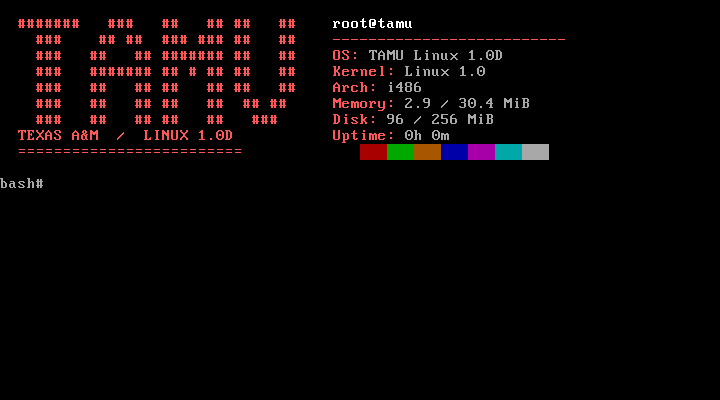
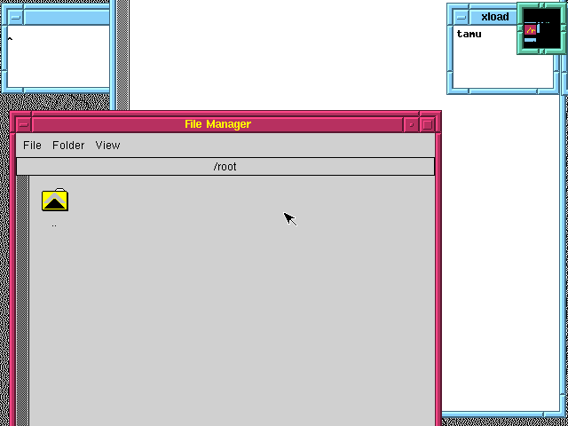

# TAMU Linux 1.0D in QEMU

[](https://github.com/clmoon2/tamu-linux-revival/actions/workflows/rebuild.yml)

Rebuild the **1994 TAMU Linux 1.0D** release from its archived boot floppy and 21 binary floppies, then run it in an isolated QEMU 486 VM. The builder downloads and checks the original media, drives the original installer, applies a small XFree86 VGA16 configuration, installs `tamu-fetch`, and boots the result to check the kernel, shell, fetch output, and desktop.

This is the original Linux 1.0-era system inside a VM. It is not a port to current laptop hardware or the earlier 1992 TAMU release.

| Original console | Original XFree86/FVWM/XFM desktop |
| --- | --- |
|  |  |

## Build and run

On Linux Mint or Ubuntu, install the host tools:

```sh
sudo apt install python3 qemu-system-x86 qemu-utils tesseract-ocr e2fsprogs
```

Then run from this repository:

```sh
python3 tools/build.py
./run.sh
```

The build downloads about 31 MB of original media from the [Princeton OldLinux mirror](https://mirror.math.princeton.edu/pub/oldlinux/Linux.old/distributions/TAMU/TAMU-1.0D/bin/3inch/). It takes a few minutes on the tested host and needs roughly 1 GB of free space while building. The resulting image is `build/tamu-1.0d.qcow2`. `run.sh` binds VNC to `127.0.0.1::5911`; connect with any VNC viewer. Log in as `root` with no password, run `tamu-fetch`, and run `startx` for the desktop. Exit X with Ctrl+Alt+Backspace, run `halt`, then enter `quit` in the QEMU monitor in the launching terminal.

The guest has no network device. VNC listens only on the host loopback address. To use another port, run `./run.sh --vnc-port 5923`. The builder uses loopback port 5922 by default; change it with `python3 tools/build.py --vnc-port 5924`. An existing output image is never overwritten; choose another path with `--output` for another build.

## What the builder checks

1. SHA-256 of the original boot image and all 21 binary images against [pinned values](checksums/sha256.txt). These values were recorded for this project; they are **not upstream-authenticated signatures**.
2. Every installer prompt and floppy request, using QEMU monitor screenshots plus Tesseract OCR with timeouts. No fixed sleep substitutes for disk installation progress.
3. A reboot from the fresh hard disk, reporting Linux 1.0 and Bash 1.13.1-CWRU. The [release announcement](https://mirror.math.princeton.edu/pub/oldlinux/Linux.old/distributions/TAMU/TAMU-1.0D/ANNOUNCE) lists Bash 1.13.5; the shell version here is the value observed inside the installed guest.
4. Byte-for-byte installation of our [minimal X configuration](config/Xconfig.tamu) and [fetch script](tamu-fetch), a 640 × 480 XFree86/FVWM/XFM desktop, clean shutdown, and read-only qcow2/ext2 checks.

Each build keeps its logs, screenshots, and a hash manifest under `build/session-*`. A failed build leaves those diagnostics and does not publish an output image. The committed [installer completion](screenshots/installer-complete.png) and [version](screenshots/version.png) captures came from a complete fresh build on QEMU 8.2.2.

## About this project

`tamu-fetch` is a small original shell script for the guest's Bash 1.13. It reads the real guest's username, hostname, kernel, architecture, memory, root disk use, and uptime. The seven-row ASCII logo and color palette work on the old console; `NO_COLOR=1 tamu-fetch` disables color. This is an independent script, not Fastfetch or Neofetch.

The original media and built VM are **downloaded or generated locally and are not committed or released here**. The archive contains many packages with their own copyrights and licenses, and we found no blanket license for redistributing the whole distribution. The MIT [license](LICENSE) covers this repository's original automation, config, fetch script, and documentation. See [technical notes](docs/ARCHAEOLOGY.md) for the installer choices, XFree86 fix, provenance, and limits of reproducibility.

The [Instagram-sized share image](social/instagram-post.png) and its [editable HTML](social/instagram-post.html) use an actual VM screenshot and label the QEMU guest.
